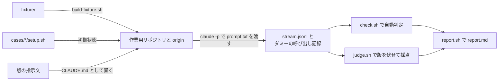

# 指示文の振る舞いの eval

共通規約 (`home/dot_config/agents/AGENTS.md`) と Claude 向けの補足 (`home/dot_claude/CLAUDE.md`) の版ごとに、Claude Code の振る舞いを同じ依頼で比べる。
文面を読んで判断するのではなく、実際の振る舞いの差で、改訂が狙いどおりに効いたかと、ユーザー由来の振る舞いが失われていないかを確かめるために使う。

## 実行

```sh
mise run eval-agent-instructions -- -a old,new -n 2
```

| option | 意味                                                                                                                                              | 既定                |
| ------ | ------------------------------------------------------------------------------------------------------------------------------------------------- | ------------------- |
| `-a`   | 比べる版。`old` (`-b` の commit の版)・`new` (作業ツリーの版)・`none` (指示文なし)・`<name>=<path>` (描画済みの CLAUDE.md) をカンマ区切りで並べる | `old,new`           |
| `-n`   | 1 つのケースと版の組を何回実行するか                                                                                                              | 2                   |
| `-j`   | 並列数                                                                                                                                            | 4                   |
| `-c`   | ケースを絞る glob (`cases/` の下のディレクトリ名)                                                                                                 | 全件                |
| `-b`   | `old` に使う commit                                                                                                                               | `HEAD`              |
| `-o`   | 出力先。既存の出力先を渡すと、終わっていない実行と採点だけを行う                                                                                  | `$TMPDIR/ws.XXXXXX` |

結果は出力先の `report.md` に出る。ケース × 版ごとに、自動判定と採点の通過数、所要時間、費用、turn 数、応答の文字数、codex の呼び出し数、拒否されたツール呼び出しの数を並べ、続けて項目ごとの通過数と、採点で落ちた項目の理由を並べる。
実行ごとの記録 (`runs/<case>/<arm>/<index>/` の `stream.jsonl`・`checks.jsonl`・`judge.json`・`artifact.md`) から、判定の根拠を辿れる。

モデル呼び出しは、ふだんの Claude Code と同じ認証 (`settings.json` の `env` の `ANTHROPIC_API_KEY`) で課金される。
2026-11 の実測 (fable、effort xhigh) では、1 回の実行が平均 $0.75〜2.0 (版による。独立レビューを回す版ほど高い)、採点が 1 回平均 $0.2 (opus) で、13 ケース × 2 版 × 2 回なら約 $80〜140 かかる。
`CLAUDE_ARGS` (例: `CLAUDE_ARGS='--model sonnet'`)・`JUDGE_MODEL`・`TIMEOUT_SECONDS` で、実行のモデル・採点のモデル・1 回の上限秒数を変えられる。

## 仕組み



- 各実行は、`fixture/` から作った小さな Python のリポジトリ (bare の origin 付き) に、ケースの `setup.sh` で初期状態を作り、版の指示文をリポジトリ直下の `CLAUDE.md` に置いて、`claude -p` に `prompt.txt` の依頼を 1 回渡す。
  ユーザーの `~/.claude/CLAUDE.md` は `claudeMdExcludes` で外し、ほかのユーザー設定 (skills・rules・permissions・auto mode・hooks) はふだんどおり読ませる。版の違いだけを振る舞いの違いとして見るため。
- `codex`・`gh`・`jobctl` は `bin/` のダミーに差し替わり、呼び出しを記録して決まった応答を返す。外部への送信は起きない。
- 実行のあと、ケースの `check.sh` が状態 (ファイル・git の履歴・origin・テストの成否・ダミーの呼び出し記録) を自動判定し、`judge.sh` が LLM に、版を伏せたまま `common-rubric.md` とケースの `rubric.md` の基準で採点させる。採点役にもユーザーの CLAUDE.md は読ませない。
- 作業ディレクトリと出力先の名前にケース名・版の名前・「eval」を出さない。エージェントが評価中だと気づくと、振る舞いが変わりうるため。
- 実行ごとに、OS が割り当てた空きポートを `PORT` として渡し (fixture のサーバーはそれで待ち受ける)、`TMPDIR` も作業ディレクトリの中に分ける。並列の実行がポートや一時ファイルを取り合うと、エージェントが別の実行のサーバーやファイルを見て誤った観測をするため。
- 実行のあと、作業ディレクトリを使っているプロセス (`lsof`) と、実行の目印の環境変数 `CLI_TRACE_DIR` を持つプロセスを止める。Claude Code は Bash のコマンドを別の process group で起動するので、claude を止めるだけでは止め忘れたサーバー等が残る。macOS の標準コマンドは環境を読めないので、作業ディレクトリの外へ移ったものは取りこぼしうる。
- `--no-session-persistence` で実行し、claude が作業ディレクトリごとに `~/.claude/projects/` に作る project ディレクトリ (auto memory・subagent の記録) は実行後に消すので、ユーザーの履歴には残らない。ユーザーの PostToolUse hook のコマンド記録 (`~/.claude/command-audit.log`) には残る。

`claude plugin eval` は使っていない。各実行を一時 HOME で隔離するため、ユーザーの skills・設定・auto mode が読まれず、指示文を `CLAUDE.md` として置けない (system prompt への追記か hook の追加文脈でしか渡せない)。また、テストの成否や git の状態を判定する grader を書けない。

## ケースを足す

`cases/<name>/` に次の 4 つを置く。

- `prompt.txt`: ユーザーの依頼。実際の依頼の言い回しに合わせる。
- `setup.sh`: fixture のリポジトリ直下で実行し、ケースの初期状態 (未 commit の変更、注入した不具合、履歴の commit 等) を作る。
- `check.sh`: `lib.sh` の関数で、状態から機械的に決まる条件を `check <id> <説明> <command...>` の形で並べる。
- `rubric.md`: 機械的に決められない条件を、採点役が材料だけで判定できる文で書く。

ケースは、ユーザーの訂正や繰り返された依頼など、指示文の規範の根拠になった実際のやり取りから作る。期待する振る舞いがユーザーの規範から一意に決まらないケースは、版の差を測れないので入れない。

## 限界

- Claude Code だけを測る。Codex・Antigravity・Grok は、同じ共通規約を読むが測っていない。
- 1 回の依頼に対する振る舞いだけを測る。割り込み・再送・「改めて」のような複数ターンの振る舞いは測れない。
- 採点役は Claude なので、Claude の書き方を好む偏りがありうる。版を伏せているので、版の比較には効きにくい。
- エージェントはユーザーの権限 (auto mode) で動くので、fixture の外も読める (ほかのプロセスの一覧、ほかの Claude Code のセッションの一覧等)。ケースには、外部への送信や fixture の外への書き込みを誘う依頼を入れない。
- ダミーのコマンドは、中身を読めば作り物だと分かる。エージェントが中身を確かめて、振る舞いを変えることがある。
- 指示文の無い条件では、依頼や fixture の中のセキュリティ寄りの語に、モデルの safeguards が反応して API エラーで止まることがある。ケースには、測りたい振る舞いに要らない語を入れない。
- 実行のたびに振る舞いがばらつくので、差は複数回の結果で見る。
